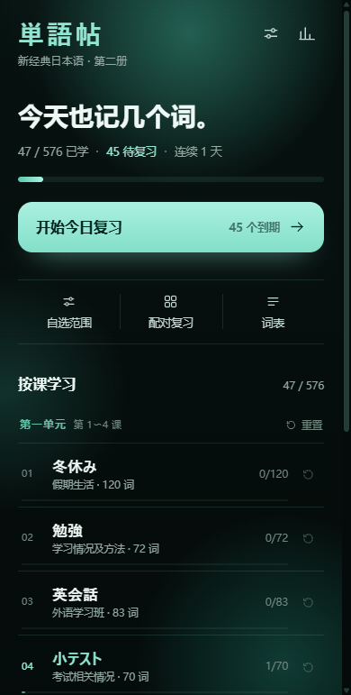
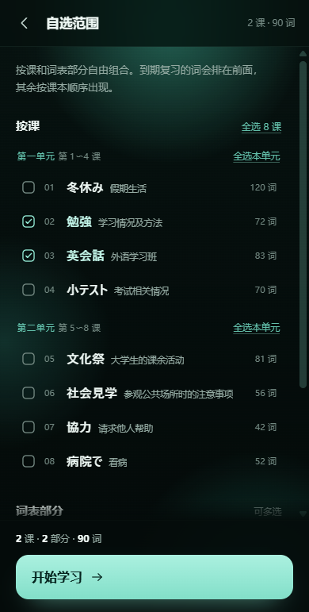
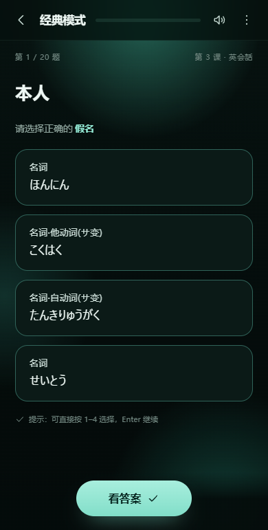
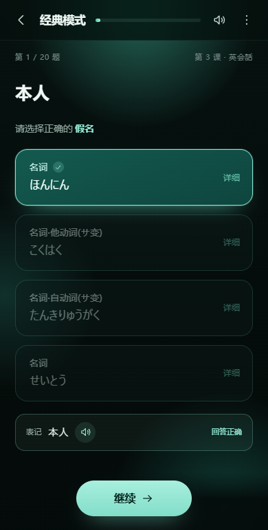
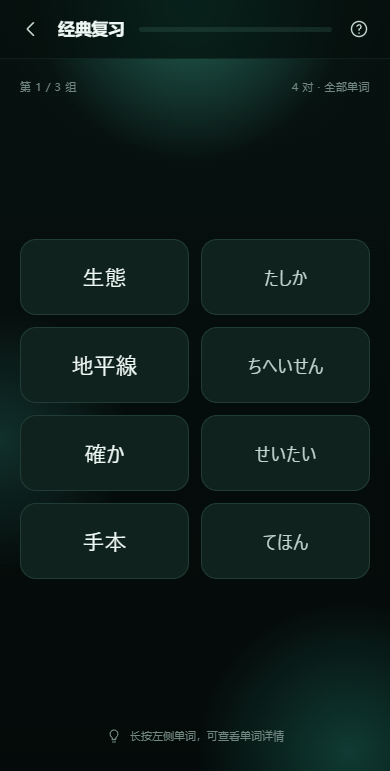
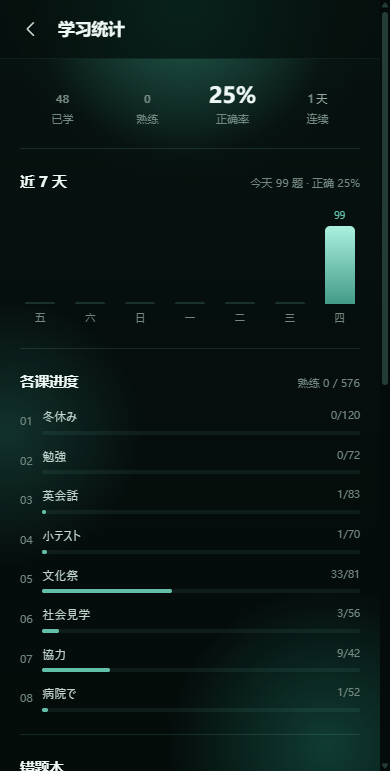

# 単語帖 · 新经典日本语单词记忆

《新经典日本语 基础教程 第二册（第三版）》第 1〜8 课单词记忆小软件。
**单文件、离线、双击即用**，按参考截图复刻了「经典模式」与「经典复习」，并在此之上加了自选范围、四种问法、
分区重置和一套更完整的视觉与动效。

**在线版（手机直接打开）**：<https://145896-dotcom.github.io/tango-cho/>


打开方式：

- 手机 / 在线：直接访问上面的网址（进度存在该浏览器的本地，换浏览器不通用）。
- 离线：双击 **`单词记忆.html`**（`D:\工作区1\单词记忆.html`，与项目同级），用 Chrome / Edge 打开即可；
  数据同样只保存在本机浏览器里，不上传任何服务器。

| 首页 | 自选范围 | 经典模式 |
| --- | --- | --- |
|  |  |  |

| 答题后 | 经典复习 | 学习统计 |
| --- | --- | --- |
|  |  |  |

---

## 功能

| 模块 | 说明 |
| --- | --- |
| 经典模式 | 四选一，**四种问法**：看词选义 / 看词选假名 / 看义选假名 / 看假名选义，也可「混合」随机。答完标出正确项、每个选项可点「详细」；键盘 `1–4` 选择、`Enter` 继续 |
| 经典复习 | 连连看。左列单词、右列假名，一组 4 对、共 3 组；长按左侧单词看释义 |
| 自选范围 | 按「课 × 词表部分」自由组合：8 课多选、6 个词表部分多选、按单元一键全选，底部实时显示「几课 / 几部分 / 多少词」再开练 |
| 分区重置 | 首页每个单元、每一课都有重置按钮，自选范围页还能「重置所选范围」；只清这一块的复习记录，其它课和总正确率不动 |
| 词表 | 576 词全表，按课筛选、中/日/罗马音搜索、显示罗马音开关、点开词条详情 |
| 学习统计 | 已学 / 熟练 / 正确率 / 连续天数、近 7 天柱状图、各课进度、错题本 |
| 设置 | 每轮题数（10/20/30/全部）、出题方向（5 档）、答题后自动发音、导出/导入/重置进度 |

复习排程用的是 **FSRS-6**（`ts-fsrs`）：答对的词间隔逐渐拉长，答错或看答案的词会更早回来；
「待复习」按到期时间统计，首页的「开始今日复习」只排到期词。

### 四种问法

| 设定 | 题目显示 | 要选 |
| --- | --- | --- |
| 看词选义 | 词形（汉字/假名词） | 中文词义 |
| 看词选假名 | 词形 | 假名读音 |
| 看义选假名 | 中文词义 | 假名读音 |
| 看假名选义 | 假名读音 | 中文词义 |
| 混合 | 以上四种每题随机 | — |

本身是假名的词（132 个）只出「看词选义」，因为问假名等同于直接给答案。

## 词库

- 来源：`04-单词表-按单元-Word版.docx`（第 1〜8 课，不含练习单词），共 **578 个词条**。
- 「作家」「そんなに」各在同一课的两张表里重复一次，合并后得到 **576 张词卡**。
- **444 张**带汉字（有假名读音），**132 张**本身就是假名/片假名。
- 词性照录原书（`名`、`自五`…），界面显示时映射为中文（`名词`、`自动词·五段`…）。
- 每个词都带着「第几课 / 哪个词表（基础会话、应用会话 1·2、正文、句型、注解）」。

重新生成词库：

```bash
python tools/build_words.py "C:/path/to/04-单词表-按单元-Word版.docx"
# → src/data/words.json
```

## 界面与动效参考

UI 参照你给的四个站点做了取用，没有整包搬组件，只把合适的手法移植过来：

- [MotionSites.ai](https://motionsites.ai/) —— 整体动势参考：大字号、克制的单一登场动效、缓慢漂移的光。
- [React Bits](https://github.com/DavidHDev/react-bits) —— **Aurora** 背景光晕、**Spotlight Card** 卡片跟随光斑、**Count Up** 数字滚动。
- [Aceternity UI](https://ui.aceternity.com/) —— 分段控件的 **layout 滑动指示条**、主按钮的 **shimmer / 移动高光**。
- [Uiverse](https://uiverse.io/) —— 开关、chip、按钮的按压与悬停细节。
- [motiondivision/motion](https://github.com/motiondivision/motion) —— 题目切换的弹簧位移 + 模糊；分段控件的 `layoutId` 共用布局动画。

同时克制掉了这类站点的常见套路：没有渐变文字、没有满屏粒子、没有给每张卡片都加同一套入场动画；
一屏只保留一个有主张的动效，其余交给间距和层级。

## 用到的开源项目

- [open-spaced-repetition/ts-fsrs](https://github.com/open-spaced-repetition/ts-fsrs) — FSRS 间隔复习算法
- [motiondivision/motion](https://github.com/motiondivision/motion) — 弹簧 / 布局动画
- [richardtallent/vite-plugin-singlefile](https://github.com/richardtallent/vite-plugin-singlefile) — 内联成单个 HTML，离线双击可用
- [WaniKani/WanaKana](https://github.com/WaniKani/WanaKana) — 假名转罗马音
- [rany2/edge-tts](https://github.com/rany2/edge-tts) — 生成 576 段日语读音（仅构建期使用，不随页面运行）
- [catdad/canvas-confetti](https://github.com/catdad/canvas-confetti) — 完成一轮时的小庆祝
- [vitejs/vite](https://github.com/vitejs/vite) · [facebook/react](https://github.com/facebook/react)

## 本地开发

```bash
pnpm install
pnpm dev        # 本地开发（默认 http://localhost:5173）
pnpm build      # 类型检查 + 打包，产物 dist/index.html（单文件）
```

**发布更新**：`pnpm build` 后把 `dist/index.html` 覆盖到 `docs/index.html`，提交并推送，
GitHub Pages 会在一两分钟内重新部署（当前 Pages 源：`main` 分支的 `/docs` 目录）。

窗口按手机设计（最大 560px 居中），电脑上也能正常用。

## 目录

```
src/
  data/words.json    词库（576 词，含课次/词性/释义）
  data/catalog.ts    词库索引与检索
  lib/audio.ts       预录读音（探测 / 预加载 / 播放，失败退回语音合成）
  lib/srs.ts         FSRS 封装（评级、掌握度、到期判断）
  lib/quiz.ts        出题：四种问法、干扰项挑选
  lib/session.ts     一轮取词（到期优先，再新词；支持课×部分自选）
  screens/           首页 / 经典模式 / 经典复习 / 自选范围 / 词表 / 统计
  components/        顶栏、选项卡、分段控件、数字滚动、底部弹层、Toast、图标
  store.tsx          进度、正确率、连续天数、错题本、分区重置（localStorage）
  styles.css         深青绿主题 + 光晕背景 + 动效
tools/build_words.py 从 DOCX 重建词库
tools/build_audio.py 用 edge-tts 生成 docs/audio/ 下的读音
docs/index.html      线上版（GitHub Pages 源：main 分支 /docs）
docs/audio/          576 段读音 mp3
dist/index.html      打包好的单文件成品
```

## 说明

- 发音优先用随站点提供的预录读音；只有拿不到录音时（离线单文件、断网）才退回浏览器语音合成，
  这时才依赖系统的日语语音。「学习统计 → 发音」会显示当前用的是哪种，以及各系统的语音安装步骤。
- 进度存在浏览器 localStorage：换浏览器或清理网站数据会丢，可在「学习统计 → 导出进度」备份成 JSON 再导入。
- Firefox 对 `file://` 页面的 localStorage 有限制；用 Chrome / Edge 双击打开最稳妥。

## 发音

- **线上版每个词都带一段预录读音**：`docs/audio/<词卡-id>.mp3`，共 576 段（日语女声，语速 −5%）。
  答题后自动播放，点词条里的喇叭也能单独听，**不依赖设备是否装了日语语音**。
- 离线单文件版旁边没有 `audio/` 目录时，会自动退回浏览器的语音合成（这时才需要系统日语语音）；
  「学习统计 → 发音」会显示当前用的是录音还是系统语音，并提供各系统的语音安装步骤。
- 重新生成录音：`pip install edge-tts` 后运行 `python tools/build_audio.py`（已存在的文件会跳过，可断点续跑）。

## 版权与数据

- 词表整理自《新经典日本语 基础教程 第二册（第三版）》第 1〜8 课，版权归原书作者与出版社，
  这里仅用于个人背诵练习，请勿用于商业分发。
- 代码部分可自由参考与修改；如果要在自己的项目里用，建议只取实现思路，词库换成你有权使用的数据。

